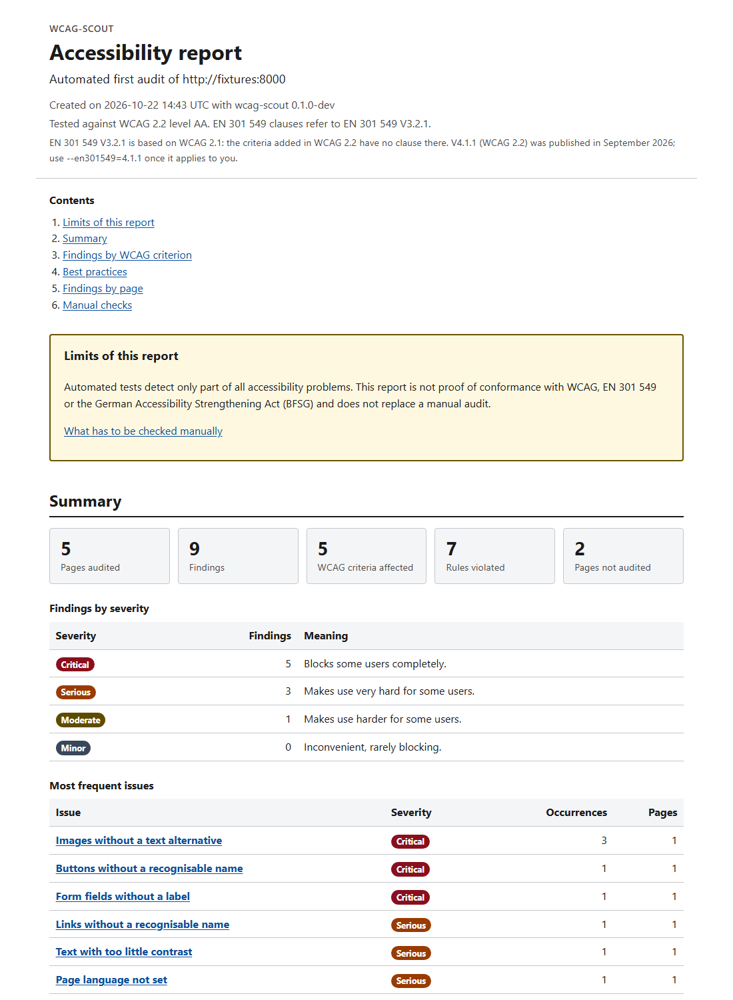
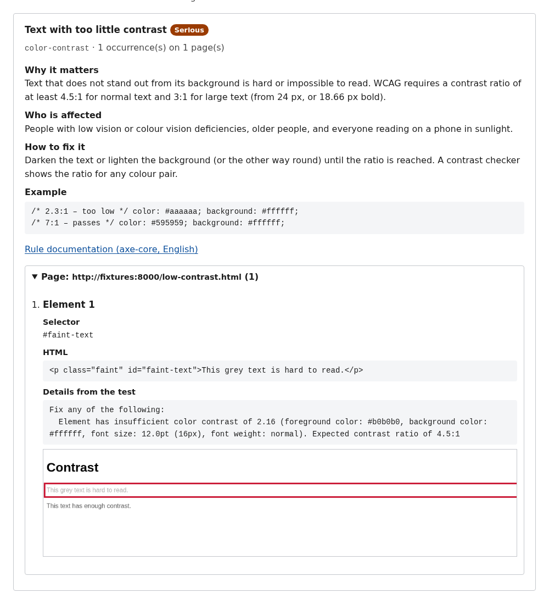
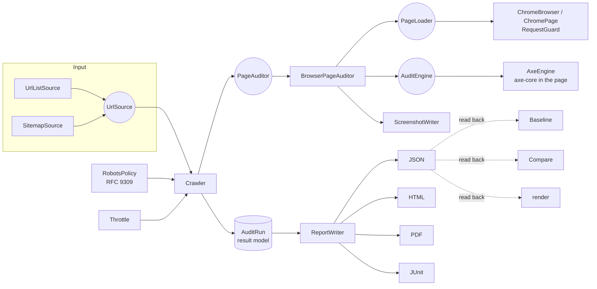

# wcag-scout

[](https://github.com/locorida/wcag-scout/actions/workflows/ci.yml)


[](LICENSE)

**A polite accessibility crawler.** wcag-scout loads public web pages in headless Chromium,
checks them with [axe-core](https://github.com/dequelabs/axe-core) and writes reports that map
every finding to **WCAG 2.2** and **EN 301 549**: HTML for people, PDF for clients, JSON for
tools and JUnit for CI. Reports are available in English and German.

It is built to give a solid **first audit**: every finding comes with the affected element, a
screenshot with the element outlined, and a plain-language explanation of why it matters, who
is affected and how to fix it.



> [!IMPORTANT]
> Automated tests detect only part of all accessibility problems. A wcag-scout report is not
> proof of conformance with WCAG, EN 301 549 or the German Accessibility Strengthening Act
> (BFSG), and it does not replace a manual audit. Every report says so and lists what has to be
> checked by hand. See [Limits of automated testing](#limits-of-automated-testing).

## Contents

- [Features](#features)
  - [How it relates to browser extensions such as WAVE or axe DevTools](#how-it-relates-to-browser-extensions-such-as-wave-or-axe-devtools)
- [Quickstart](#quickstart)
- [Commands and options](#commands-and-options)
- [Reports](#reports)
- [Using it in CI](#using-it-in-ci)
- [Architecture](#architecture)
- [Limits of automated testing](#limits-of-automated-testing)
- [Crawling other people's websites responsibly](#crawling-other-peoples-websites-responsibly)
- [Development](#development)
- [Licence](#licence)

## Features

- **Input:** single URLs, a URL list file, or a sitemap (sitemap indexes and `.xml.gz` included).
  Optionally follows links within the same site.
- **Polite crawling:**
  - honours `robots.txt` (RFC 9309, including `Crawl-delay`);
  - pauses between requests (1 s by default) and stops after a page limit (50 by default);
  - sends its own user agent with a contact URL;
  - **never sends data to a site** (see below).
- **Findings:**
  - WCAG criterion and level, EN 301 549 clause and severity for every finding;
  - selector, HTML excerpt and element screenshot;
  - an explanation and a fix.
- **Reports:**
  - an accessible HTML report, also as a tagged PDF;
  - JSON as the result of record and JUnit XML for CI;
  - English and German.
- **Baseline mode:** accept today's findings, then fail CI only for new ones.
- **Comparison:** shows what was fixed, what is new and what is unchanged between two runs.
- **GitHub Action** and a Docker image, so nothing has to be installed locally.

### How it relates to browser extensions such as WAVE or axe DevTools

Browser extensions check **one page, in the state you are looking at**, with visual markers in
context. They are the right tool for a manual deep dive: logged-in areas, open menus, error
states, reading order.

wcag-scout checks **many pages, unattended and reproducibly**. It produces a lasting report for
clients and a pass/fail signal for CI, with a baseline and a comparison between runs. It only
sees pages as they load and never interacts with them.

The tools complement each other. WAVE uses its own engine and also flags possible issues for
human review, so it finds things that axe-core does not report and the other way round. A
typical workflow: wcag-scout for the site-wide first audit and for regression checks, and an
extension plus the manual checklist for the pages that matter most.

## Quickstart

### Without installing anything: in your own GitHub repository

1. Open the template **[locorida/wcag-scout-template](https://github.com/locorida/wcag-scout-template)**
   and click **Use this template** → *Create a new repository*. Choose **Private**.
2. In your new repository, go to **Actions** → **Accessibility audit** → **Run workflow**.
   Enter a sitemap or URLs.
3. After the run, download the report from the run's **Artifacts**.

The report only ends up in your own repository. The runs count against your own Actions
minutes, and nothing is stored anywhere else.

### With Docker

```bash
docker run --rm -v "$PWD:/report" ghcr.io/locorida/wcag-scout:0.1.0 audit https://example.com/ --lang en
```

PowerShell:

```powershell
docker run --rm -v "${PWD}:/report" ghcr.io/locorida/wcag-scout:0.1.0 audit https://example.com/ --lang de
```

To build the image yourself instead: `docker build -t wcag-scout .`, then use `wcag-scout` as
the image name. The examples below do that.

The reports end up in `./wcag-scout-report/`. Open `report.html`.

On Linux, the image's unprivileged user (UID 1000) needs write access to the mounted directory.
If your UID differs, add `--user "$(id -u):$(id -g)"`.

More examples:

```bash
# A whole site via its sitemap, all formats, German
docker run --rm -v "$PWD:/report" wcag-scout audit --sitemap https://example.com/sitemap.xml \
  --format html,pdf,json,junit --lang de --max-pages 100

# Start page plus the pages it links to, slower, with your own contact address
docker run --rm -v "$PWD:/report" wcag-scout audit https://example.com/ \
  --follow-links --max-depth 1 --delay 3 --contact-url https://your-company.example/contact

# Report times in your time zone
docker run --rm -e TZ=Europe/Berlin -v "$PWD:/report" wcag-scout audit https://example.com/
```

### Without Docker

Requirements:
- PHP 8.5 with the `dom`, `sockets`, `xmlreader`, `xmlwriter` and `zlib` extensions;
- Composer;
- Chromium or Google Chrome.

```bash
composer install --no-dev
CHROME_PATH=/usr/bin/chromium bin/wcag-scout audit https://example.com/
```

## Commands and options

### `audit`: audit pages and write reports

```
wcag-scout audit [<urls>...] [options]
```

| Option | Default | Description |
|---|---|---|
| `<urls>` | | URLs to audit. Give exactly one of URLs, `--urls-file` or `--sitemap`. |
| `-f, --urls-file` | | Text file with one URL per line; `#` starts a comment. |
| `-s, --sitemap` | | URL of a sitemap or sitemap index. |
| `-o, --output` | `wcag-scout-report` | Directory for the reports. |
| `--format` | `html,json` | Comma-separated: `html`, `pdf`, `json`, `junit`. |
| `-l, --lang` | `en` | Report language: `en` or `de`. |
| `--level` | `AA` | Highest WCAG level to test: `A`, `AA` or `AAA`. |
| `--no-best-practices` | | Only test WCAG criteria and skip axe-core's best-practice rules. |
| `--en301549` | `3.2.1` | EN 301 549 version for clause references: `3.2.1` or `4.1.1` (see below). |
| `-m, --max-pages` | `50` | Maximum number of pages to load. Skipped pages do not count. |
| `-d, --delay` | `1` | Pause between requests to the same site, in seconds. A longer `Crawl-delay` in robots.txt wins. |
| `--follow-links` | | Also audit links found on audited pages (same site only). |
| `--max-depth` | `2` | Link depth for `--follow-links`. |
| `--contact-url` | project URL | Contact URL sent in the user agent. Set it to your own. |
| `-t, --timeout` | `30` | Timeout per page, in seconds. |
| `--screenshots` | `3` | Element screenshots per rule and page; `0` disables them. |
| `-b, --baseline` | | Baseline file: findings listed there do not fail the run. |
| `--fail-on` | `minor` | Lowest severity that fails the run: `critical`, `serious`, `moderate`, `minor`, `never`. |
| `--chrome-path` | `$CHROME_PATH` or `chromium` | Chromium/Chrome binary. |

**Exit codes:**

| Code | Meaning |
|---|---|
| `0` | No findings at or above `--fail-on`. With a baseline: no new ones. |
| `1` | Findings that fail the run. |
| `2` | Invalid options or input files. |
| `3` | The audit could not run (browser, network, file system). |

Best-practice findings never fail a run: they are not WCAG failures.

### `baseline`: accept known findings

```
wcag-scout baseline wcag-scout-report/report.json [-o wcag-scout-baseline.json]
```

### `compare`: compare two runs

```
wcag-scout compare before/report.json after/report.json [-o wcag-scout-comparison] [--lang de]
```

Writes `comparison.html` and `comparison.json` with these categories:
- **new**
- **fixed**
- **unchanged**
- **not checked again**: findings on pages the later run did not audit. They never count as fixed.

The exit code is 1 if there are new findings.

### `render`: rebuild reports from JSON

```
wcag-scout render wcag-scout-report/report.json --format html,pdf --lang de
```

`render` needs no new crawl. It is useful for a report in the other language or with the other
EN 301 549 version. The per-element messages from axe-core stay in the language of the original
audit.

## Reports

| File | For | Contents |
|---|---|---|
| `report.html` | People | Summary with key figures, findings grouped by WCAG criterion and rule (explanation, fix, example, every affected element with screenshot), best practices, findings per page, pages not audited and why, manual checklist |
| `report.pdf` | Clients | The HTML report printed by Chromium, all details expanded, tagged PDF with bookmarks |
| `report.json` | Tools | Every finding with fingerprint, criteria and both EN 301 549 clause versions; the result of record that `render`, `baseline` and `compare` read |
| `junit.xml` | CI | One test suite per page, one test case per rule; only findings that fail the run are failures |
| `screenshots/` | | PNGs of the affected elements, outlined in red |



**The HTML report is accessible itself.** It has:
- landmarks, a skip link and a strict heading order;
- tables with captions and header cells;
- severities written out, never shown by colour alone, and AA contrast;
- visible focus.

The CI pipeline audits the generated report with axe-core and fails on any finding. This check
caught a real problem during development: two landmarks had the same name.

### EN 301 549 versions

For web content, chapter 9 of EN 301 549 adopts WCAG levels A and AA one to one: WCAG `x.y.z`
becomes clause `9.x.y.z`.

| Version | Based on | Status (October 2026) |
|---|---|---|
| **V3.2.1** (default) | WCAG 2.1 | Cited in the Official Journal of the EU, so it is the legal reference under the Web Accessibility Directive and the European Accessibility Act (BFSG in Germany). The six criteria new in WCAG 2.2 have no clause here and are marked as such. |
| V4.1.1 | WCAG 2.2 | Published by ETSI in September 2026. Its citation in the Official Journal is expected but was still pending at the time of writing. |

Switch with `--en301549=4.1.1` once V4.1.1 applies to you. Check the current status of the
citation yourself; this README will not stay up to date with it.

## Using it in CI

### GitHub Action

```yaml
- uses: locorida/wcag-scout@v0.1.0
  with:
    sitemap: https://staging.example.com/sitemap.xml
    format: html,pdf,junit
    lang: en
    baseline: .wcag-scout-baseline.json
    fail-on: serious
- uses: actions/upload-artifact@v4
  if: always()
  with:
    name: accessibility-report
    path: wcag-scout-report
```

All inputs are listed in [`action.yml`](action.yml). The action writes a findings summary to
the job summary and sets the outputs `report-dir` and `exit-code`. It uses the pre-built image
`ghcr.io/locorida/wcag-scout-action`, so a run starts within seconds.

> [!NOTE]
> In a **public** repository, workflow artifacts, job summaries and logs, including the audited
> URLs, are visible to everyone. Audit other people's websites from a private repository.

### Introducing it on a site with existing problems

```bash
wcag-scout audit --sitemap https://staging.example.com/sitemap.xml --format json
wcag-scout baseline wcag-scout-report/report.json -o .wcag-scout-baseline.json
git add .wcag-scout-baseline.json   # reviewers see rule, page and selector of every accepted finding
```

From then on, `--baseline .wcag-scout-baseline.json` fails the build only for new findings.
Fingerprints are built from rule, page and selector, not from the element's HTML. Changing
markup such as CSRF tokens or cache-busting URLs therefore does not turn known findings into new
ones.

## Architecture



| Layer | Namespace | Responsibility |
|---|---|---|
| Input | `Input\` | Where URLs come from. Sources are lazy, so a huge sitemap is never read completely. |
| Crawl | `Crawl\` | *Which* pages, in what order, how fast: scope, robots.txt, throttle, deduplication, link following. Knows nothing about browsers. |
| Browser | `Browser\` | The only code that knows chrome-php. Loads a page, guards its requests, takes element screenshots, prints PDFs. |
| Engine | `Engine\` | The checks that run in a loaded page. `AxeEngine` maps axe-core's results to findings. |
| Model | `Model\`, `Standards\` | Immutable result model, WCAG 2.2 catalogue, EN 301 549 mapping. |
| Report | `Report\`, `Knowledge\` | Renderers, translations, plain-language explanations. |
| CLI | `Cli\` | Option parsing and wiring. |

**Extension points**

| To add | Implement | Notes |
|---|---|---|
| A check engine, e.g. focus order via keyboard simulation | `Engine\AuditEngine` | Pass it to `BrowserPageAuditor` |
| A report format, e.g. SARIF for GitHub code scanning | `Report\Renderer` | Register it in `Cli\Reports` |
| An input | `Input\UrlSource` | |

The result model does not depend on axe-core.

**Design decisions**

- **chrome-php/chrome rather than symfony/panther.**
  - chrome-php speaks the Chrome DevTools Protocol directly. It needs no chromedriver binary
    whose version must match Chromium.
  - It gives access to request interception, element screenshots and `Page.printToPDF` with
    tagged output.
  - Panther targets end-to-end tests of Symfony applications through WebDriver.
- **PDF from Chromium**, not a PHP PDF library. Report and PDF have the same layout, and
  Chromium produces a tagged PDF.
- **JSON as the result of record.** Every other format can be rebuilt from it, so a client
  report in another language needs no second crawl.

## Limits of automated testing

Automated tools find only part of all accessibility barriers. In the UK Government Digital
Service's 2017 comparison, automated tools found about 30 % of deliberately introduced barriers.
Deque reports 57 % when counting by number of occurrences instead of distinct problems. Either
way, much is left to a human. What wcag-scout cannot judge:

- **Whether content is meaningful.** An image can have an alt text that says nothing, and a
  label can be present but misleading.
- **Keyboard use and focus order.** Can everything be reached and operated without a mouse, in
  a sensible order, with a visible focus and no trap?
- **Placeholders as labels.** A field with only a placeholder has an accessible name, so axe-core
  does not report it, although WCAG 3.3.2 considers this insufficient. The fixture
  [`form.html`](tests/fixtures/site/form.html) documents this case.
- **Language and comprehensibility** of texts, instructions and error messages.
- **Screen reader experience**, including dynamic content and status messages.
- **States behind interaction.** wcag-scout audits pages as they load. Menus, dialogs, form
  errors and content behind logins are not tested, because the crawler never clicks or types.
- **Media.** Whether captions or audio descriptions exist and are correct.
- **Zoom and reflow.** Pages are checked at a single desktop viewport of 1280 × 800.
- **Frames** are not entered (`iframes: false`). Elements in shadow DOM are checked but get no
  screenshot.
- **Overlays** such as cookie banners are audited as they are and may hide other content in
  screenshots.

Each report ends with a checklist of these manual checks.

## Crawling other people's websites responsibly

wcag-scout is designed to be a good citizen, but the responsibility stays with you.

- **Only audit sites you are allowed to audit.** That means your own, your client's with their
  consent, or public sites within their terms of use.
- **robots.txt is honoured:**
  - according to RFC 9309;
  - if robots.txt cannot be reached (5xx, network error), the crawler stops for that site;
  - a `Crawl-delay` longer than `--delay` is respected.
- **Keep the defaults or slow down.** Use `--delay 1` or more and a sensible `--max-pages`.
  Running against production during peak hours is rarely necessary.
- **Identify yourself.** Set `--contact-url` to an address where the site operator can reach
  you. It is sent in the user agent as `wcag-scout/<version> (+<contact-url>)`, appended to
  Chromium's own user agent.
- **wcag-scout never sends data:**
  - requests other than GET, HEAD and OPTIONS are blocked, whether they come from forms,
    `fetch()`, XMLHttpRequest or `sendBeacon()`;
  - after the load event, any further navigation of the page is cancelled;
  - the integration tests prove this against a page that tries to submit itself;
  - consequence: analytics or consent scripts that post data fail during an audit.
- **Logins are out of scope.** wcag-scout does not fill in credentials.

**Security note on the Docker image.**
- The tool runs as an unprivileged user.
- Chromium's own sandbox needs kernel capabilities that a default container does not grant, so
  it is disabled inside the container, and the container is the isolation boundary.
- Do not run the image with `--privileged` or extra capabilities when auditing sites you do not
  trust.

## Development

All tooling runs in the dev image, so only Docker is needed.

```powershell
.\scripts\dev.ps1 composer install
.\scripts\dev.ps1 composer ci                 # code style, PHPStan, licence check, unit tests
.\scripts\dev.ps1 composer test:integration   # Chromium + axe-core against tests/fixtures
```

| Command | What it does |
|---|---|
| `composer test` | Unit tests |
| `composer test:integration` | Integration tests, Chromium required |
| `composer analyse` | PHPStan, level max with strict rules |
| `composer cs` / `cs:fix` | PHP-CS-Fixer (PER-CS) |
| `composer check:licenses` | Fails on runtime dependencies outside the licence allow list |

**Fixtures.** [`tests/fixtures/site`](tests/fixtures/site) is a small website with deliberate
errors, served by PHP's built-in web server during the tests. Each page states in comments which
findings it must produce. Further fixtures:
- a `robots.txt` that disallows a page, which must never be requested;
- a sitemap index;
- a 404;
- a page whose scripts try to send data.

**No test or example touches a real external website.**

**CI** ([`.github/workflows/ci.yml`](.github/workflows/ci.yml)) runs:
- code style, static analysis, the licence check, and unit and integration tests;
- the builds of the runtime and action images;
- an example audit with each image against the fixture site, with the example report uploaded
  as an artifact.

## Licence

wcag-scout is released under the [MIT licence](LICENSE).

It bundles **axe-core** (© Deque Systems, Inc.) under the **Mozilla Public License 2.0**:
- `resources/axe/` contains the unmodified files with their licence and source reference;
- MPL-2.0 is a file-level licence and does not extend to wcag-scout's own code.

[`THIRD_PARTY_NOTICES.md`](THIRD_PARTY_NOTICES.md) explains the obligations and lists all
dependencies and their licences. They are all permissive, and CI checks them on every build.
